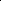

# qrtc

Send a file between two devices directly. No server, no account — the handshake is a QR code.

**Live:** https://gfxroy.github.io/qrtc/



## How it works

WebRTC normally depends on an external signaling server (WebSocket, HTTP polling, or Firebase) to swap session descriptions (SDP offers and answers) between two peers. `qrtc` eliminates the signaling server completely by turning the devices' screens and cameras into the signaling channel.

### 1. SDP Minifier

Standard WebRTC SDP offers and answers are verbose text documents between 1.5 KB and 4 KB. An uncompressed SDP would produce an extremely dense QR code that standard mobile cameras struggle to scan reliably.

`qrtc` extracts only the essential session parameters:
- `ice-ufrag` and `ice-pwd`
- DTLS SHA-256 fingerprint (compacted from 95 characters of hex string into 32 raw bytes)
- SCTP port (encoded as uint16)
- ICE candidates (`host` and `srflx`), encoding IPv4 addresses as 4 raw bytes, IPv6 as 16 raw bytes, and ports as uint16.

The extracted binary payload is compressed using raw DEFLATE (`deflate-raw` via `fflate`) and encoded as `base64url`. This reduces typical offers and answers down to ~70–100 characters (well under our 300-character target). When scanned, the decoder expands the compact binary back into an RFC-compliant full SDP accepted by Chrome, Firefox, and Safari.

### 2. Zero-Signaling Handshake

1. **Offer Generation:** The sender gathers ICE candidates using Google's public STUN server (`stun:stun.l.google.com:19302`) with a 3-second timeout for non-trickle gathering.
2. **Display:** The minified offer is displayed as a high-contrast QR code and a direct copyable link (`https://gfxroy.github.io/qrtc/#o=<blob>`).
3. **Receiver Answering:** The receiver scans the QR code or opens the link, creates a local peer connection, gathers its candidates, and presents an answer QR code + code.
4. **Connection:** The sender scans or pastes the answer. Once applied, WebRTC connectivity checks complete and the `RTCDataChannel` opens.

### 3. DataChannel Transfer Protocol & Backpressure

- **Chunking:** Files are read in fixed 64 KB slices.
- **Backpressure:** WebRTC data channels have internal buffer limits. When sending large files at high speed, `bufferedAmount` will rapidly overflow if unbounded. `qrtc` monitors `bufferedAmountLowThreshold` (set to 256 KB) and pauses chunk reads until the browser signals `bufferedamountlow`.
- **Streaming Incremental SHA-256:** Browser `crypto.subtle` does not support streaming hash updates for incoming chunks. `qrtc` implements an incremental pure TypeScript SHA-256 engine. Each 64 KB chunk is hashed as it is transmitted and received. When the transfer ends, the receiver verifies the digest against the sender's final hash before triggering file download.

### 4. Safety Code

Both peers derive a 4-word safety code from a sorted SHA-256 hash of their combined DTLS fingerprints. Users can visually confirm the 4 words match on both screens to verify that no party altered the handshake in transit.

## Limitations

- **Symmetric NATs:** Direct peer-to-peer WebRTC connections require at least one peer to have an addressable STUN candidate (full cone, restricted cone, or port-restricted cone NAT). When both devices are behind symmetric NATs (common on cellular data networks and corporate firewalls), direct traversal is mathematically impossible without a TURN relay server. In such environments, both devices must be on the same local Wi-Fi or connected to a mobile hotspot.
- **Background Tabs on Mobile:** Mobile operating systems (especially iOS Safari) throttle background timers and suspend WebRTC data channels when the screen locks or the browser switches tabs. Keep the browser open until transfer completes.
- **Camera Access:** Browser camera scanning requires a secure context (`https://` or `localhost`).

## Development

```bash
# Install dependencies
npm install

# Start local development server
npm run dev

# Run unit and integration tests (Vitest)
npm test

# Typecheck TypeScript
npm run typecheck

# Lint codebase
npm run lint

# Production build
npm run build

# Build for GitHub Pages
npm run build:pages
```

## License

MIT License

Copyright (c) 2026 Aaditya Roy
